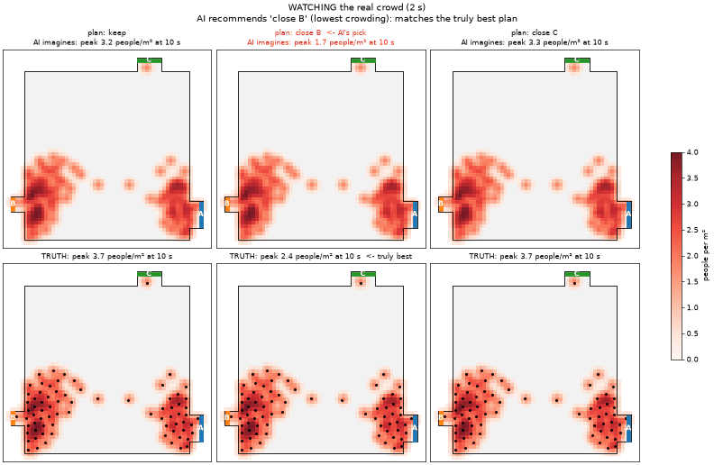

# Crowd World Model

An AI that watches 2 seconds of a crowd from above and imagines the next 10 seconds.

- It guesses what it can't see: where each person is heading and how rushed they are.
- You can ask "what if?": close a gate, or have a train arrive, and it shows how the crowd would react.
- It gives odds of dangerous crowding instead of just one guess.
- It can **plan**: it imagines every gate plan and recommends the safest.



*The AI watches 2 s of a crowd, imagines 10 s under each gate plan (top) and recommends the one with the least crowding. Bottom: what really happens under each plan (re-simulated). Here closing gate B breaks up the queue, and the AI saw it coming.*

| Synthetic station | Real lab bottleneck (Jülich) | Real train platform (Eindhoven) |
|---|---|---|
|  |  |  |

*Left: what really happened. Right: what the AI imagined, with people coloured by the exit it thinks they're heading for. Bottom: people in view, real (black) vs the AI's forecast (red) and its 80% range (shaded). Real clips are typical moments (the model's median accuracy on that recording), not hand-picked.*

## How it works

1. **Simulator.** A crowd simulator ([JuPedSim](https://www.jupedsim.org)) tuned to match real lab experiments.
2. **Synthetic data.** 15,000 simulated scenes (halls, platforms, bottlenecks) with gates, train arrivals and hidden goals.
3. **The picture.** Every scene becomes a 64×64 map (0.25 m per cell, 5 frames per second): crowd density, walls, exits, gates and arrivals.
4. **The model.** A recurrent memory that watches the frames, then predicts how people *move* between neighbouring cells. People can't vanish, appear from nowhere or walk through walls. A small random "mood" variable lets it imagine several possible futures.
5. **Real data.** It's fine-tuned on real recordings (Jülich lab experiments, Eindhoven Centraal station platform), always tested on runs and days it never saw. Synthetic scenes are also shown through smaller "camera views", so it learns that people walk in and out at the edge of the picture.

## Results

Error 10 s ahead, compared with assuming "nothing moves" (1.00 means no better; lower is better):

| Test set (never seen in training) | Keep walking straight | **This model** |
|---|---|---|
| Synthetic scenes | 1.25 | **0.55** |
| Jülich bottlenecks | 1.52 | **0.51** |
| Lab crossings | 1.39 | **0.79** |
| Eindhoven platform (days 7–9) | 1.30 | **0.86** |

**"What if?" questions** (1,034 held-out moments, each re-simulated under 2–3 gate plans):

- **Direction of a gate action's effect:** correct 93% of the time, for each exit. It predicts about 73% of the true size.
- **Picking the safest plan:** when changing a gate truly makes things safer, the AI finds the right change 80% of the time. Overall it picks the least-crowded plan 80% of the time, versus 72% for "never touch the gates" and 49% for a random pick.
- **Crowd map 10 s ahead:** 0.28 against "nothing moves".

**Other skills:**

- **Guessing destinations:** 96% correct on synthetic scenes, 88% on real crossings, 85% on the real platform.
- **Guessing hurry:** it ranks the more motivated crowd correctly in 10 of 11 real experiment pairs.
- **Headcount ranges:** its 80% range contains the real headcount 10 s later in 76–83% of test cases (66% at crossings). The range is calibrated on training runs.
- **People in and out:** over 10 s it gets the flow budget roughly right (Eindhoven: 17 in and 18 out for real, vs 20 and 22 predicted).
- **Danger odds:** much better than guessing on synthetic scenes, Jülich and crossings; no better than guessing on the Eindhoven platform.

**Limitations:** it predicts crowd density, not individual people. It can't see surges coming, such as a group still downstairs about to walk up, so its forecast is a smooth average. On the real platform it is only modestly better than "nothing moves". Its own imagined futures vary too little in headcount, so the ranges come from calibration instead. The real datasets are small.

## Run it

Setup: [docs/SETUP.md](docs/SETUP.md) (conda, PyTorch with CUDA; tested on one 8 GB laptop GPU).

```bash
# 1. Tune the simulator to the real experiments
python scripts/calibrate_sim.py

# 2. Make synthetic data
python scripts/generate_scenes.py --n 6000 --start 0     --version v3 --family hall
python scripts/generate_scenes.py --n 5000 --start 6000  --version v3 --family platform
python scripts/generate_scenes.py --n 4000 --start 11000 --version v3 --family bottleneck
python scripts/prepare_dataset.py --version v3

# 3. Convert real data (put the raw files in data/raw first)
python scripts/prepare_real.py

# 4. Train on synthetic data, then fine-tune on real data
python scripts/train_wm.py --data v3 --name final_pre --z_dim 8 --beta 0.15 --prior_every 2 --prior_mean \
    --horizon 30 --batch 8 --steps 40000 --lr 3e-4
python scripts/train_wm.py --data v3 --name final_real --init_from final_pre --z_dim 8 --beta 0.15 \
    --prior_every 2 --prior_mean --horizon 30 --batch 8 --steps 5000 --lr 1e-4 \
    --real juelich,crossing,eindhoven \
    --real_holdout "caserne_bottleneck_2006__b120,caserne_bottleneck_2006__b200,hermes_bottleneck_2009__ao-360-400,crossing_90_d_2,crossing_90_d_8,crossing_90_e_3,day7_*,day8_*,day9_*"
# (then two more 5000-step fine-tunes with the same settings: final_real_b from final_real,
#  and final_real_c from final_real_b with --crop 0.5)

# 5. Test, calibrate headcount ranges, make GIFs
python scripts/make_whatif.py --split test --per_scene 4      # what-if moments
python scripts/eval_whatif.py --run final_real_c --save
python scripts/show_planner.py --run final_real_c --moment scene_001319_k225
python scripts/final_check.py --run final_real_c
python scripts/calibrate_bands.py --run final_real_c
python scripts/show_people.py --run final_real_c --start typical --dir data/processed/real/juelich/caserne_bottleneck_2006__b120
```

## Code

| Folder | What's inside |
|---|---|
| `src/crowdwm/sim/` | Scene generator and simulator helpers |
| `src/crowdwm/data/` | Real-data loaders, training windows |
| `src/crowdwm/model/` | The world model |
| `src/crowdwm/raster*.py` | Turns people's positions into the 64×64 map |
| `scripts/` | The steps above |
| `tests/` | Checks: people are never created or lost, no walking through walls |

## Coming next

An online demo, and the what-if dataset as a public benchmark.
