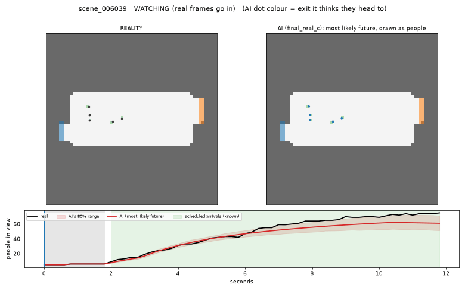
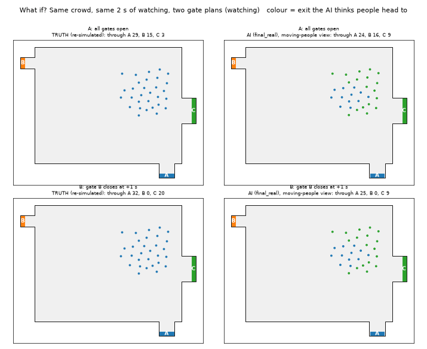
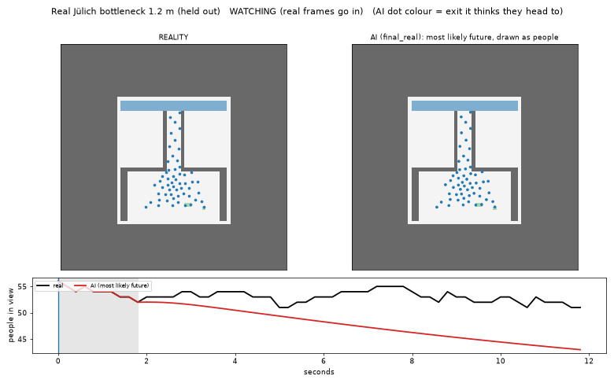
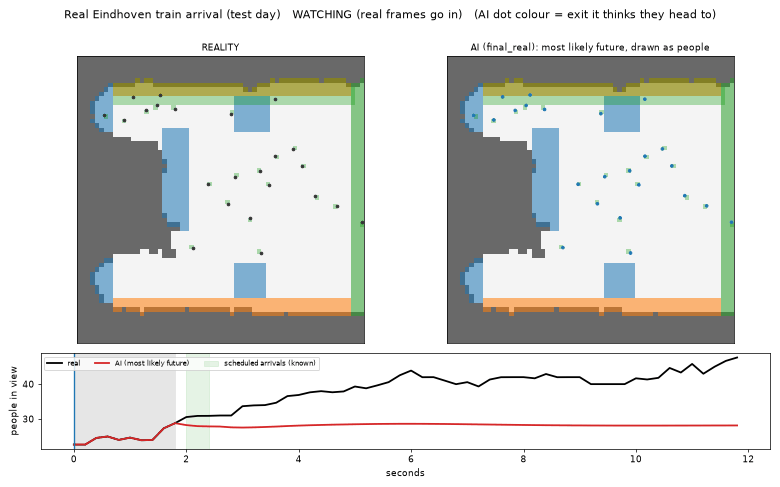

# Crowd World Model

An AI that watches 2 seconds of a crowd from above and imagines the next 10 seconds.

- It guesses what it can't see: where each person is heading and how rushed they are.
- You can ask "what if?": close a gate, or have a train arrive, and it shows how the crowd would react.
- It gives odds of dangerous crowding instead of just one guess.

| Synthetic station | What if a gate closes? |
|---|---|
|  |  |

| Real lab bottleneck (Jülich) | Real train platform (Eindhoven) |
|---|---|
|  |  |

*Left half of each GIF: what really happened. Right half: what the AI imagined, with people coloured by the exit it thinks they're heading for.*

## How it works

1. **Simulator.** A crowd simulator ([JuPedSim](https://www.jupedsim.org)) tuned to match real lab experiments.
2. **Synthetic data.** 15,000 simulated scenes (halls, platforms, bottlenecks) with gates, train arrivals and hidden goals.
3. **The picture.** Every scene becomes a 64×64 map (0.25 m per cell, 5 frames per second): crowd density, walls, exits, gates and arrivals.
4. **The model.** A recurrent memory that watches the frames, then predicts how people *move* between neighbouring cells. People can't vanish, appear from nowhere or walk through walls. A small random "mood" variable lets it imagine several possible futures.
5. **Real data.** It's fine-tuned on real recordings (Jülich lab experiments, Eindhoven Centraal station platform), always tested on runs and days it never saw.

## Results

Error 10 s ahead, compared with assuming "nothing moves" (1.00 means no better; lower is better):

| Test set (never seen in training) | Keep walking straight | **This model** |
|---|---|---|
| Synthetic scenes | – | **0.69** |
| Jülich bottlenecks | 1.3–1.5 | **0.55** |
| Lab crossings | 1.3–1.5 | **0.83** |
| Eindhoven platform (days 7–9) | 1.3–1.5 | **0.91** |

- **Guessing destinations:** 96% correct on synthetic scenes, 88% on real crossings, 85% on the real platform.
- **Guessing hurry:** it ranks the more motivated crowd correctly in 10 of 11 real experiment pairs.
- **Danger odds:** better than the base rate on every test set.

**Limitations:** it predicts crowd density, not individual people. Headcount is less accurate where people walk in or out at the camera's edge. Its sampled futures are noisy on real data, so the "most likely" future is the one to trust. The real datasets are small.

## Run it

Setup: [docs/SETUP.md](docs/SETUP.md) (conda, PyTorch with CUDA; tested on one 8 GB laptop GPU).

```bash
# 1. Tune the simulator to the real experiments
python scripts/calibrate_sim.py

# 2. Make synthetic data
python scripts/generate_scenes.py --n 6000 --start 0     --version v3 --family hall
python scripts/generate_scenes.py --n 5000 --start 6000  --version v3 --family platform
python scripts/generate_scenes.py --n 4000 --start 11000 --version v3 --family bottleneck
python scripts/prepare_dataset.py --version v3

# 3. Convert real data (put the raw files in data/raw first)
python scripts/prepare_real.py

# 4. Train on synthetic data, then fine-tune on real data
python scripts/train_wm.py --data v3 --name final_pre --z_dim 8 --beta 0.15 --prior_every 2 --prior_mean \
    --horizon 30 --batch 8 --steps 40000 --lr 3e-4
python scripts/train_wm.py --data v3 --name final_real --init_from final_pre --z_dim 8 --beta 0.15 \
    --prior_every 2 --prior_mean --horizon 30 --batch 8 --steps 5000 --lr 1e-4 \
    --real juelich,crossing,eindhoven \
    --real_holdout "caserne_bottleneck_2006__b120,caserne_bottleneck_2006__b200,hermes_bottleneck_2009__ao-360-400,crossing_90_d_2,crossing_90_d_8,crossing_90_e_3,day7_*,day8_*,day9_*"

# 5. Test and make GIFs
python scripts/final_check.py --run final_real
python scripts/show_people.py --run final_real --dir data/processed/real/juelich/caserne_bottleneck_2006__b120
python scripts/show_whatif.py --run final_real
```

## Code

| Folder | What's inside |
|---|---|
| `src/crowdwm/sim/` | Scene generator and simulator helpers |
| `src/crowdwm/data/` | Real-data loaders, training windows |
| `src/crowdwm/model/` | The world model |
| `src/crowdwm/raster*.py` | Turns people's positions into the 64×64 map |
| `scripts/` | The steps above |
| `tests/` | Checks: people are never created or lost, no walking through walls |

## Coming next

A planner that picks the best gate plan, an online demo, and the synthetic dataset as a public benchmark.
